## Hey there 🤙

I'm Joshua Luna-Li, a fourth year Computer Science student at Toronto Metropolitan University (formerly Ryerson).
My program focus is on Machine Learning and Computer Vision, but outside of school you might find me:

- 🚵 Shredding the trails
- 🏂 Dropping in
- 📷 Looking for the perfect shot
- 🏹 Shooting for gold

## Projects

### Web Apps

| Project | What it does | Built with |
| --- | --- | --- |
| [BoardShapes](https://github.com/joshualunali/boardshapes) | Overlays snowboard outlines to scale so you can compare shapes, sizes and specs, and picks each board's size from your weight. The outlines are rebuilt from the widths, sidecut radius and setback that Burton, Jones and Nidecker publish, and a Python scraper collects those specs from their size charts. [Try it live](https://joshualunali.github.io/boardshapes/) | JavaScript, SVG, Python |

### Machine Learning & Computer Vision

| Project | What it does | Built with |
| --- | --- | --- |
| [Hand-Tracking Audio Control](https://github.com/joshualunali/Hand-Tracking-Audio-Control-Mapping) | Controls Windows system volume from a webcam by tracking the pinch distance between thumb and index finger, calibrating to your hand as it runs. [Try the browser version](https://joshualunali.github.io/Hand-Tracking-Audio-Control-Mapping/) | Python, MediaPipe, OpenCV, JavaScript |
| [Clustering Research Project](https://github.com/joshualunali/Clustering-Research-Project) | Measures how standardisation and PCA change K-Means results on a wheat seed dataset, using WCSS, silhouette score and entropy | Python, scikit-learn, pandas |
| [Keras Handwriting Sandbox](https://github.com/joshualunali/Keras-Handwriting-Sandbox) | Trains a fully connected neural network to classify handwritten MNIST digits | Python, Keras, TensorFlow |
| [Decision Tree Classifier](https://github.com/joshualunali/SciKit-Classifier-Testing) | Builds a decision tree classifier on Wisconsin breast cancer imaging data | Python, scikit-learn |
| [Regression Testing](https://github.com/joshualunali/SciKit-Regression-Testing) | Tests linear and logistic regression models, including one-vs-one and one-vs-rest | Python, scikit-learn |

### Keyboards & Firmware

| Project | What it does | Built with |
| --- | --- | --- |
| [HID Remapper: nice!nano Bluetooth](https://github.com/joshualunali/hid-remapper) | Fork of jfedor2's HID Remapper. Ported the Bluetooth firmware to the nice!nano, fixed devices being rejected when their HID report types don't match their properties, and added LED blink codes for debugging pairing | C++, Zephyr, nRF52 |
| [zmk-nice-oled](https://github.com/joshualunali/zmk-nice-oled) | Personal fork of a ZMK display module, adding TMU and Nu Gundam logos as selectable screen images | C, ZMK |
| [zmk-onekey](https://github.com/joshualunali/zmk-onekey) | Minimal ZMK shield for a single switch wired straight to a nice!nano, built by GitHub Actions | ZMK, Devicetree |

## Tech Stack

**Languages**

![C#](https://img.shields.io/badge/c%23-%23239120.svg?style=for-the-badge&logo=data:image/svg%2Bxml;base64,PHN2ZyBmaWxsPSJ3aGl0ZSIgcm9sZT0iaW1nIiB2aWV3Qm94PSIwIDAgMjQgMjQiIHhtbG5zPSJodHRwOi8vd3d3LnczLm9yZy8yMDAwL3N2ZyI%2BPHBhdGggZD0iTTEuMTk0IDcuNTQzdjguOTEzYzAgMS4xMDMuNTg4IDIuMTIyIDEuNTQ0IDIuNjc0bDcuNzE4IDQuNDU2YTMuMDg2IDMuMDg2IDAgMCAwIDMuMDg4IDBsNy43MTgtNC40NTZhMy4wODcgMy4wODcgMCAwIDAgMS41NDQtMi42NzRWNy41NDNhMy4wODQgMy4wODQgMCAwIDAtMS41NDQtMi42NzNMMTMuNTQ0LjQxNGEzLjA4NiAzLjA4NiAwIDAgMC0zLjA4OCAwTDIuNzM4IDQuODdhMy4wODUgMy4wODUgMCAwIDAtMS41NDQgMi42NzNabTUuNDAzIDIuOTE0djMuMDg3YS43Ny43NyAwIDAgMCAuNzcyLjc3Mi43NzMuNzczIDAgMCAwIC43NzItLjc3Mi43NzMuNzczIDAgMCAxIDEuMzE3LS41NDYuNzc1Ljc3NSAwIDAgMSAuMjI2LjU0NiAyLjMxNCAyLjMxNCAwIDEgMS00LjYzMSAwdi0zLjA4N2MwLS42MTUuMjQ0LTEuMjAzLjY3OS0xLjYzN2EyLjMxMiAyLjMxMiAwIDAgMSAzLjI3NCAwYy40MzQuNDM0LjY3OCAxLjAyMy42NzggMS42MzdhLjc2OS43NjkgMCAwIDEtLjIyNi41NDUuNzY3Ljc2NyAwIDAgMS0xLjA5MSAwIC43Ny43NyAwIDAgMS0uMjI2LS41NDUuNzcuNzcgMCAwIDAtLjc3Mi0uNzcyLjc3MS43NzEgMCAwIDAtLjc3Mi43NzJabTEyLjM1IDMuMDg3YS43Ny43NyAwIDAgMS0uNzcyLjc3MmgtLjc3MnYuNzcyYS43NzMuNzczIDAgMCAxLTEuNTQ0IDB2LS43NzJoLTEuNTQ0di43NzJhLjc3My43NzMgMCAwIDEtMS4zMTcuNTQ2Ljc3NS43NzUgMCAwIDEtLjIyNi0uNTQ2di0uNzcySDEyYS43NzEuNzcxIDAgMSAxIDAtMS41NDRoLjc3MnYtMS41NDNIMTJhLjc3Ljc3IDAgMSAxIDAtMS41NDRoLjc3MnYtLjc3MmEuNzczLjc3MyAwIDAgMSAxLjMxNy0uNTQ2Ljc3NS43NzUgMCAwIDEgLjIyNi41NDZ2Ljc3MmgxLjU0NHYtLjc3MmEuNzczLjc3MyAwIDAgMSAxLjU0NCAwdi43NzJoLjc3MmEuNzcyLjc3MiAwIDAgMSAwIDEuNTQ0aC0uNzcydjEuNTQzaC43NzJhLjc3Ni43NzYgMCAwIDEgLjc3Mi43NzJabS0zLjA4OC0yLjMxNWgtMS41NDR2MS41NDNoMS41NDR2LTEuNTQzWiIvPjwvc3ZnPg%3D%3D)

**Machine Learning & Data**

**Tools & Platforms**

**Hardware & Firmware**

